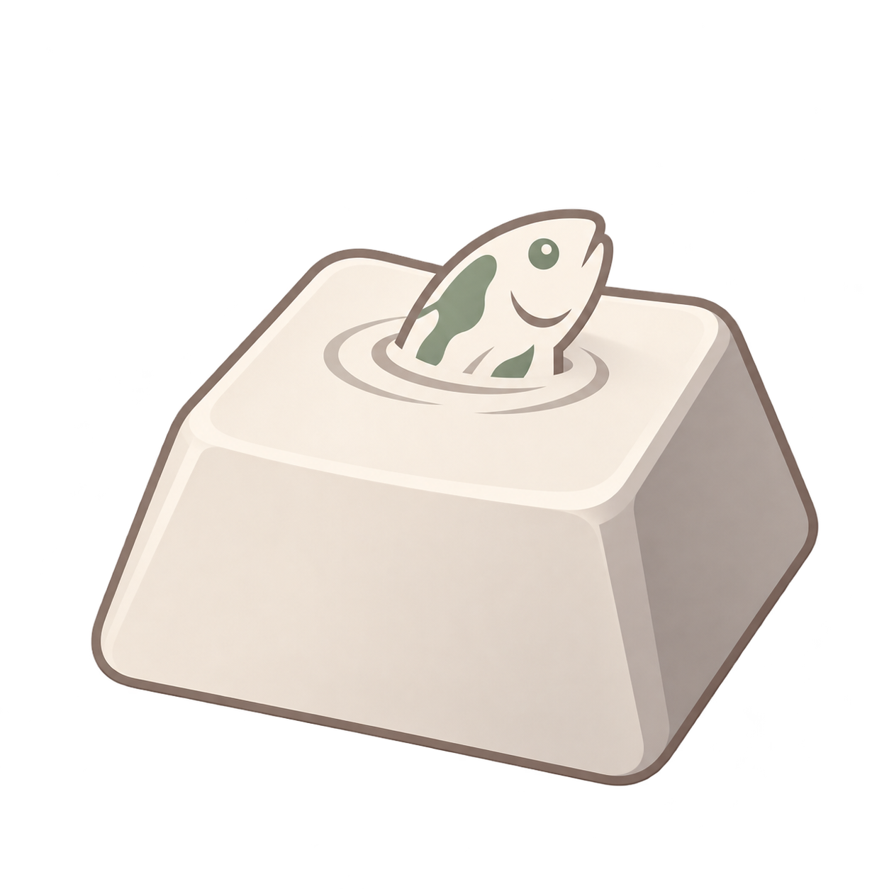
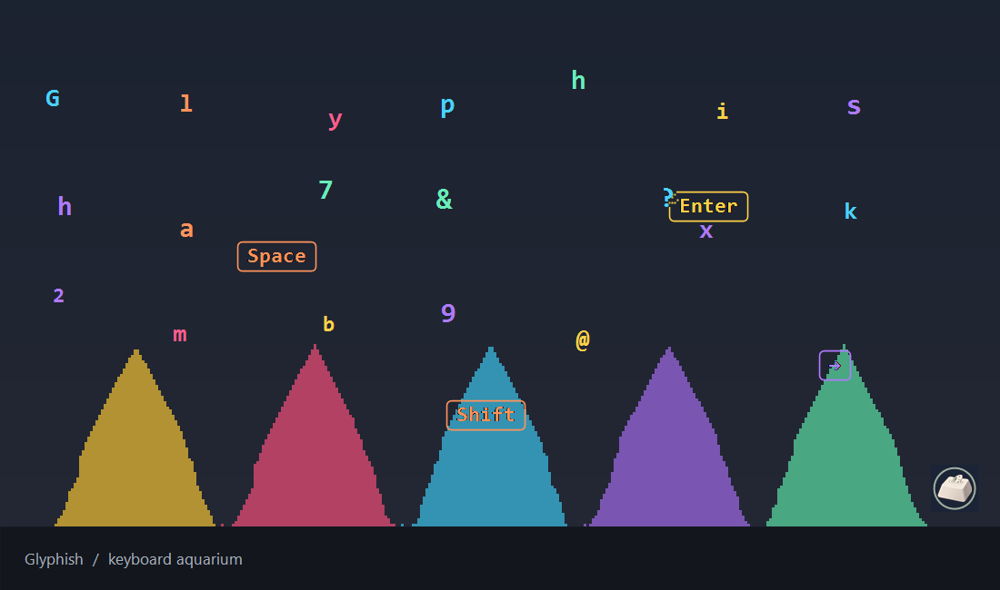
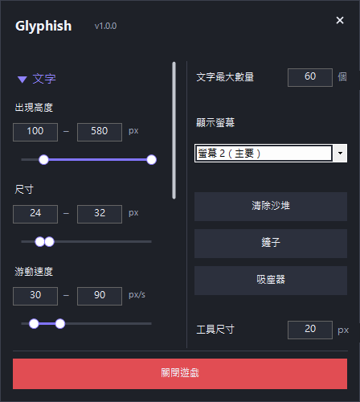
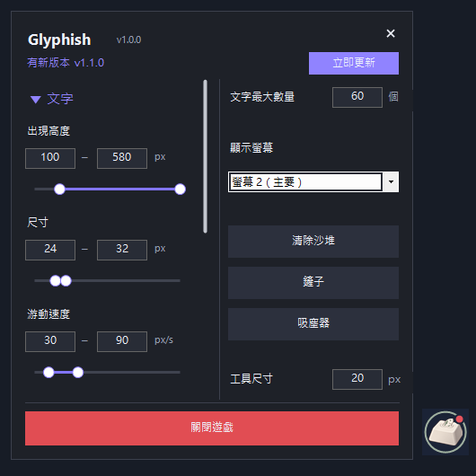



  

<h1 align="center">Glyphish</h1>

A tiny aquarium for your keyboard.

讓文字游動，讓按鍵成為飼料，把桌面變成一座小魚缸。

  <a href="https://github.com/Ivla/Glyphish/releases/latest">下載最新版</a> ·
  <a href="#開始遊玩">開始遊玩</a> ·
  <a href="#版本更新">版本更新</a>

> 圖中使用程式實際渲染器與示範資料；深色背景和下方橫條僅供展示。遊戲本身是透明桌面圖層，沙堆落在所選螢幕的工作列上緣。

## 這是什麼？

Glyphish 是 Windows 桌面小遊戲。你在其他應用程式打字時，英文字母、數字與符號會變成彩色的「文字魚」；Space、Tab、Enter、Shift、方向鍵等按鍵則變成慢慢下沉的飼料。

- **會游動的文字**：新魚出現時稍微下沉；平時每 2～5 秒重新選擇方向與速度，平滑轉向。
- **魚會找吃的**：啄到之前持續找最近的飼料，追食速度為一般速度的 1.5 倍；啄到後才鎖定。
- **一口一口吃掉按鍵**：每次啄食間隔 1 秒，接觸處逐漸破碎；目標消失後休息 3 秒再找下一塊。
- **留下彩色沙堆**：飼料碰到底部或既有沙堆會碎裂成沙，沉積後顏色變暗 30%。
- **滑鼠會驚動魚**：碰到文字魚時，魚會往外游開。
- **桌面持續可操作**：遊戲圖層穿透點擊；設定頁開啟時，魚缸仍持續運作。

## 開始遊玩

1. 到 [Releases](https://github.com/Ivla/Glyphish/releases/latest) 下載 **Glyphish.exe**。
2. 放到你有寫入權限的資料夾，直接執行；不需要安裝程式。
3. 開始打字，即可生成文字魚與按鍵飼料。
4. 左鍵點擊懸浮球開啟或關閉設定；按住拖曳可移動懸浮球。
5. 在設定頁按「關閉遊戲」即可完全結束程式及輸入監聽。

**系統需求**：Windows 10 / 11 桌面環境、.NET Framework 4.8。程式使用 Windows Forms，不支援 macOS 或 Linux。初次下載的未簽署 EXE 可能出現 Windows SmartScreen 提示。

設定儲存在 EXE 旁的 <code>settings.xml</code>，搬移程式時可一起帶走。從舊 KeyAquarium 改名為 Glyphish 時，保留同一份設定即可沿用。

## 調整你的魚缸

| 設定 | 用途 |
|---|---|
| 文字 | 出現高度、尺寸、游動速度的最小／最大值 |
| 按鍵 | 出現高度、尺寸範圍與固定下沉速度 |
| 文字最大數量 | 超過上限時，最舊的文字會原地淡出 |
| 顯示螢幕 | 選擇遊玩螢幕，支援不同尺寸螢幕之間切換 |
| 工具尺寸 | 調整鏟子與吸塵器的作用直徑 |

高度以**工作列上緣為 0**，往螢幕上方增加。左側「文字」「按鍵」可收合；展開內容超過介面高度時可以捲動。

### 整理沙堆

- **鏟子**：啟用後，以滑鼠推動作用範圍內的沙粒。
- **吸塵器**：啟用後，移除作用範圍內的沙粒。
- **清除沙堆**：沙粒從最底層開始向工作列下方掉落消失。
- 再點一次目前啟用的工具即可關閉。
- 工具啟用時，在遊玩螢幕滾動滑鼠滾輪可調整尺寸；此時滾輪由工具使用，不會同時捲動底下的程式。

## 版本更新

> 圖中的 v1.1.0 為更新提示示範，不代表已發布此版本。

- 第一次啟動檢查正式 Release，之後**每 6 小時**檢查一次；重新啟動會沿用上次檢查時間。
- 發現較新正式版本時，懸浮球顯示**紅點**，設定頁上方顯示版本和「**立即更新**」。
- 點擊後下載新版，核對 GitHub 提供的 SHA-256、檔案大小與版本，再關閉舊程式、替換**同一份 Glyphish.exe**並重新啟動。
- 保留 <code>settings.xml</code>；不會自行在背景安裝更新。
- 無網路、GitHub 限流或檢查失敗時，仍可繼續遊玩；下載／替換失敗也會保留舊版。
- 只判斷正式 Release，不把程式碼提交、草稿或預發布版本當作更新。
- 也可以到 [Releases](https://github.com/Ivla/Glyphish/releases) 手動下載。

更新快取位於 <code>%LOCALAPPDATA%\Glyphish</code>。程式資料夾需要可寫入，才能直接替換 EXE。

## 輸入與網路

Glyphish 使用全域鍵盤與滑鼠掛鉤來產生遊戲物件及操作工具。**不記錄、不儲存，也不上傳輸入文字**。一般輸入會傳給原本的應用程式；啟用清理工具時，所選螢幕上的滾輪會用於調整工具尺寸。

目前文字魚以 ASCII 英文、數字與標點為主；中文輸入法組字不會作為完整中文字魚處理。

網路只用於向本 repo 的 GitHub Releases 檢查與下載更新，沒有分析追蹤或遊戲伺服器。

## 效能

完整飼料使用直接網格定位與距離剪枝，靜態沙堆使用繪圖快取，文字字型和筆刷重用；沒有動態物件時減少重繪。跨螢幕會重新分配沙粒，避免不同解析度造成沙堆直向空縫。
